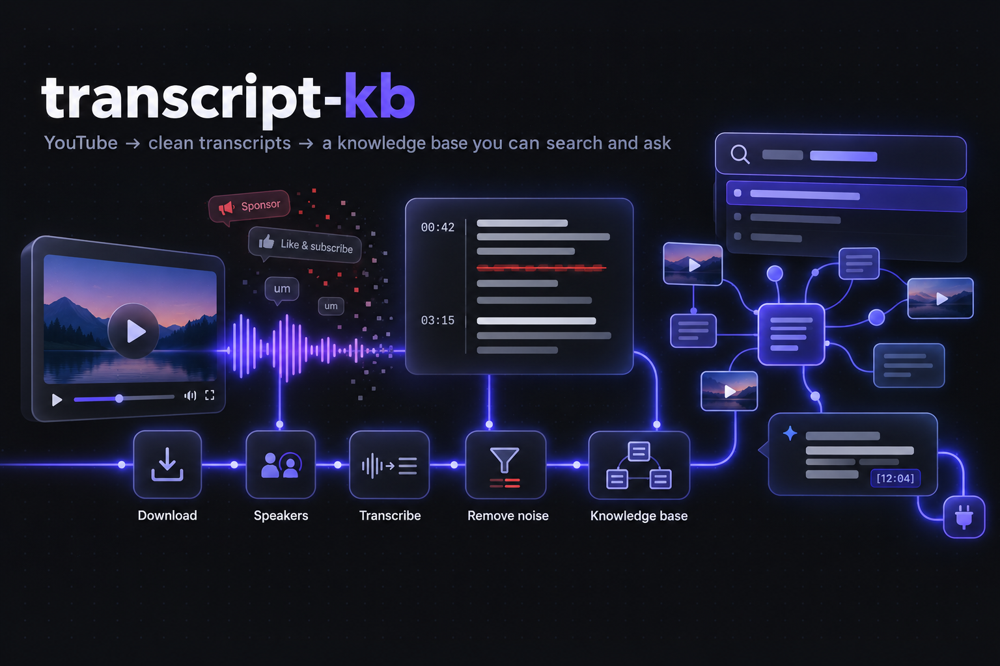

# transcript-kb



YouTube video → accurate transcript → noise-free transcript → linked knowledge base you can browse, search and ask.

## Use it

**Double-click `Transcript KB.command`** (or run `uv run tkb serve`). The app opens at http://127.0.0.1:8765.

- **Discover → Add videos**: paste links (videos, playlists or channels) and press *Add to queue*.
- **Discover → searches**: one or more searches, each with its own keywords and length, date and popularity
  filters. They run at once, each with extra phrasings written by the AI. Shorts, live streams, videos you already
  have and (with *Only new videos*) videos a search offered before are skipped; every candidate's details are read,
  the AI scores them, and the best are picked with a reason each. Press *Process selected*, or tick *Queue
  automatically*.
- **Discover → a channel**: type `@handle` or a channel URL instead of keywords, and Discover looks only at what
  that channel published: videos, Shorts, past live streams, the videos in its playlists and the videos its posts
  link to (which can be guest appearances elsewhere). The AI shortlists the most substantial from the whole
  catalogue (about 300 titles in 5 s), reads those in detail and scores them on substance, on any topic. Mix
  channels and keyword searches freely. A channel search takes about 30 s.
- **Library**: the queue and your videos. Each video moves through Download → Speakers → Transcribe → Remove noise
  → Knowledge base with live progress. A successful retry clears the video's earlier failed attempts.
- **Video page**: player, TL;DR, takeaways, clickable outline and transcript (click a sentence to jump there;
  *Follow along* highlights the line being spoken). *Show removed noise* strikes through each cut sentence with its
  reason; the *Removed* and *Warnings* tabs list them.
- **Speakers**: interviews and podcasts are labelled by speaker, with names when the video states them. *Rename*
  fixes a name instantly; *Re-detect* reruns detection with the number of speakers you know.
- **Concepts / Graph**: every concept across all videos, and a graph of which videos share which concepts; the
  graph's video list zooms to the video you click.
- **Search** (`/`): by keywords and by meaning ("how much does it cost" finds "four cents per million tokens").
  New videos are indexed for meaning in the background; until then they're found by keywords.
- **Ask**: questions answered only from your videos, with a timestamp link for every claim.
- **Delete** (trash button on a Library card): removes a video and every trace of it: files, its section in shared
  concept notes (notes only it supported go too), the index, queue history, Discover's memory of it, and saved
  Discover and Ask results that mention it. You see what will go first; it can't be undone.
- **Nothing is lost on a refresh**: processing, Discover and Ask run on the server and are saved to disk; if the
  app restarts, unfinished work resumes on its own.

### Settings

Every decision the system makes is a setting, each with a reset to its default; technical ones sit under *Show
advanced*. Each says when a change applies: now, from the *Next video*, for *New videos and Redo*, for *New
transcriptions* or at the *Next speaker detection*.

| Section | What you control |
|---|---|
| AI models | The model for each job, from any provider, written `provider/model`: `claude-code/sonnet` (the default, through your Claude Code login), `anthropic/…`, `openai/…`, `gemini/…`, `openrouter/…`, `ollama/…` and `lmstudio/…` (local, free, offline), `custom/…` (any OpenAI-compatible API: Groq, Mistral, DeepSeek, vLLM…) or `command/…` (any command-line tool that reads the request and prints the answer, e.g. `llm -m {model}`). A bare name like `haiku` means Claude Code. |
| AI providers | Keys and addresses, each with *Test connection* (which also offers the provider's models as suggestions); timeout and answer length |
| Noise removal | Which kinds of noise are cut (an unticked kind stays in, at no extra AI cost), which SponsorBlock segments are cut and how much overlap counts, when a "cleaned" sentence counts as a rewrite, flagging added numbers, ad-warning phrases |
| Transcription | Speech model and engine (MLX on Apple Silicon, faster-whisper anywhere), device, translation default, paragraph breaks |
| Speakers | Detection on/off, most speakers, speech needed, sensitivity, voice samples, grouping, shortest speech and pause, what the AI reads to name speakers |
| Splitting | Part size, smallest part, parts at chapters, merging a short last part, sentence limits |
| Notes | Kinds of concept, merging synonyms, linking new concepts to the ones you have |
| Speed | Videos at once, and how many YouTube requests, transcriptions, speaker detections and AI requests run at once |
| Discover | Lowest score, picks per channel, order of picks, every search getting a pick, extra phrasings, Shorts, shortest video, how much is read and shown to the AI, channel limits, confirmation size |
| Search and Ask | Search model (local, a provider's embeddings, or off), keyword and meaning weights, boosts per kind of result, ranking constants, ignored words, what Ask reads, removing unsupported citations |
| Watched topics, Reliability, MCP server, History | Schedule defaults, retries, MCP result sizes, what's kept |
| Prompts | Every instruction the AI gets, editable |

A video you already have is never re-cleaned or changed by a setting: it stays pinned to the values it was cleaned
with until you Redo it. Values are saved in `data/.settings.json`. Any setting with an environment variable (e.g.
`TKB_JOBS=2 uv run tkb serve`) is locked to it, and shown so.

**API keys** come from the usual environment variables (`OPENAI_API_KEY`, `ANTHROPIC_API_KEY`, `GEMINI_API_KEY`,
`OPENROUTER_API_KEY`) or are typed in: those are kept in `data/.secrets.json`, readable only by you, and never shown
again or logged. Answers are checked against the shape each job needs, so a model without structured output works
too (it's asked in the prompt, and a malformed answer is retried).

### From a terminal

```bash
uv run tkb "https://www.youtube.com/watch?v=VIDEO_ID"         # one video (also: several URLs, a playlist, a channel)
uv run tkb run PLAYLIST_URL --limit 20                        # first 20 videos of a playlist
uv run tkb run ID1 ID2 ID3 --jobs 3                           # several videos in parallel
uv run tkb run VIDEO_ID --translate                           # translate a non-English video to English
uv run tkb run VIDEO_ID --redo                                # redo noise removal and notes with today's Settings
uv run tkb run VIDEO_ID --stage speakers --num-speakers 3     # re-detect speakers with a known count
uv run tkb run VIDEO_ID --llm-model ollama/llama3.1           # one model for every job of this run
uv run tkb ask "Why does a shaken bottle foam when opened?"   # a question answered from the knowledge base
uv run tkb discover "sourdough science" "@veritasium" --pick 6   # several searches at once (add --run to process)
uv run tkb delete VIDEO_ID                                    # remove a video and every trace of it (asks first)
uv run tkb watch "sourdough science" --every 7                # follow a topic (tkb watch lists them; --off stops)
uv run tkb update                                             # upgrade yt-dlp when YouTube downloads start failing
uv run tkb mcp                                                # serve the knowledge base to AI apps (see below)
```

**Watched topics** run while the app is open: due topics are searched and up to 3 new videos (by default) queued.
A run waits while the previous run's videos are still processing, runs once after a long absence, and retries
later if YouTube rate-limits it. To run them while the app is closed, schedule `uv run tkb watch --run-due` (e.g.
hourly, with cron or launchd); it never runs a topic the app is already running. A watched channel queues the best
videos it hasn't offered yet, which early on means its back catalogue; give it a date filter in a search first to
favour new uploads.

**Setup**, once: `uv sync --python 3.13`. Needs `ffmpeg` and an AI provider: the `claude` CLI logged in (the
default), an API key, or a local model server. On an Apple Silicon Mac, Whisper runs on the GPU (MLX); anywhere
else it runs with faster-whisper on the CPU or an NVIDIA GPU. Or use Docker:

## Docker

```bash
cp .env.example .env          # optional: a Claude Code token or API keys
docker compose up -d          # builds the image, then open http://127.0.0.1:8765
```

- **What's inside**: the app and every `tkb` command, on Linux (amd64 or arm64), with ffmpeg, yt-dlp's JavaScript
  runtime and Claude Code. About 1.2 GB; `docker compose build --build-arg CLAUDE_CODE=false` leaves Claude Code out
  (940 MB). It runs as a non-root user and shuts down cleanly on `docker compose down`.
- **Transcription** uses faster-whisper: the same Whisper models and settings, on the CPU. (An NVIDIA GPU would also
  need the CUDA 12 and cuDNN 9 libraries, which this image doesn't include.) Measured on a 7-minute video, on an
  Apple Silicon Mac's CPU in Docker (14 cores): `turbo` transcribed at about 4× real time (111 s; natively, MLX on
  the GPU does 21×), speaker detection took 46 s, and the 1.6 GB model downloads once. **On an Apple Silicon Mac,
  run natively instead**; on other machines, a faster CPU or a smaller model (`small`, `distil-large-v3`) helps.
- **AI**: Claude Code needs a token in the container: run `claude setup-token` on your machine and put it in `.env`
  as `CLAUDE_CODE_OAUTH_TOKEN`. Or use an API key, or Ollama / LM Studio running on the host: inside the container
  their addresses default to `host.docker.internal`.
- **Your library** lives in the `library` volume, and downloaded models in `cache`. To use a folder instead (e.g.
  this project's `data/` and `kb/`), set `TKB_LIBRARY=.` in `.env`, but never while the Mac app is running on the
  same folder: file locks don't cross Docker's file sharing, and both would process the same queue.
- **Port**: `TKB_PORT` in `.env` (default 8765, the same as the Mac app's; pick another to run both).
- **Security**: the app is published on `127.0.0.1` only, and must stay that way: Settings can make it run a
  program (the command-line AI provider), so never publish it on a network (`-p 8765:8765`).
- **MCP**: `docker exec -i transcript-kb tkb mcp` serves the knowledge base to an AI app from the container.

## Use it from AI apps (MCP)

`tkb mcp` serves the knowledge base over MCP to Claude, Cursor or any MCP client: search (keywords and meaning),
list videos, and read a video's summary and outline, a concept note, or about 10 minutes of cleaned transcript at a
time, each passage with a link to that second of the video.

With the app open, it can also add videos: `discover` runs the app's Discover (searches, channels, filters; the AI
scores the candidates and returns the best with a reason each), `queue_videos` adds the ones you choose to the
queue, and `queue_status` shows when each is processed and readable. The app does the work, and the searches appear
in its Discover history. `discover` spends AI credits and `queue_videos` adds work, so AI apps ask before using them;
`queue_videos` takes single videos only, and nothing can delete.

- **Claude Code**: this folder's `.mcp.json` registers it (through `uv run`); Claude Code asks you to approve it the first time.
- **Claude Desktop**: quit it first (it rewrites its config while open), then add to `mcpServers` in
  `~/Library/Application Support/Claude/claude_desktop_config.json` and reopen it:
  `"transcript-kb": {"command": "/Users/you/.../transcript_kb/.venv/bin/tkb", "args": ["mcp"]}` (this folder's path).

## How it works

| Stage | What it does | Output (`data/<id>/`) |
|---|---|---|
| ingest | yt-dlp: 16 kHz mono audio and metadata (title, chapters, description) | `audio.wav`, `meta.json` |
| speakers | Who spoke when, on your Mac (see *Speakers*) | `diarization.json`, `speakers.json` |
| transcribe | Whisper (turbo by default; large-v3 for translation), on MLX or faster-whisper; each 30 s window decodes independently (prevents repetition loops); hallucination filter; paragraphs with `[mm:ss]`; word timestamps only for multi-speaker videos | `transcript.json`, `transcript.md` |
| clean | See *Noise removal* | `clean.json`, `cleaned.md`, `removed.md` |
| kb | The AI extracts concepts, facts and an outline per part, then writes the TL;DR and merges concepts with your existing notes | `kb.json`, `kb/` |

Every stage is cached and resumes. Within a video, notes for each part start as soon as that part is cleaned.

### Noise removal

The transcript is split into numbered sentences and sent in parts. For each sentence the AI either keeps it
(lightly fixed: filler words, stutters, misheard names) or drops it with a category:

| Category | Examples |
|---|---|
| Sponsor / ad read | "This video is sponsored by…", "use code … for 10% off", the whole pitch in between |
| Self-promotion | the creator's own courses, communities, newsletters, Patreon, merch, "link in the description" |
| Like / subscribe / comment | engagement requests, polls |
| Intro / sign-off, Filler / banter, Off-topic | greetings, chatter with no information, tangents |

1. **SponsorBlock first.** Community-labelled segments (sponsor, self-promotion and engagement by default) are cut
   by timestamp before the AI sees anything. The lookup uses SponsorBlock's hash-prefix API, so the video id isn't
   sent; turn it off with `--no-sponsorblock` or the checkbox.
2. **The AI decides the rest**, one entry per sentence id. The text is reassembled from the source in order, so a
   sentence the AI skips is kept, not lost, and timestamps stay exact.
3. **Checks.** Leftover ad phrasing, rewrites much longer than the source and numbers the speaker didn't say raise
   warnings, shown in the *Warnings* tab.

`removed.md` and the app list every removed sentence with its category and whether SponsorBlock or the AI removed it.

### Speakers

1. **Speech segments** come from the pyannote segmentation model, run through sherpa-onnx (no account needed).
2. **Voices**: a TitaNet speaker embedding for every few seconds of speech, then spectral clustering. The number of
   speakers is read from the eigengap of the similarity graph, which counted correctly on all 5 test videos (1, 1,
   2, 3 and 4 speakers), where fixed-threshold clustering split 4 people into 9 to 27 "speakers".
3. **Names**: the AI reads the title, description, the opening and the lines around each speaker change. A name is
   kept only if its quoted evidence really appears in the video; otherwise the speaker is "Host", "Guest" or
   "Speaker N".
4. Each sentence gets the speaker who talks most during it, so cleaning, notes, search and Ask all see the names.

The models (about 47 MB) download once to `~/.cache/tkb/models`, checked against pinned SHA-256 hashes. Detection
runs at about 16× real time; skip it with `--no-speakers`.

### Knowledge base (`kb/`, Obsidian-compatible)

- `index.md`: all videos and concepts
- `videos/<title>-<id>.md`: TL;DR, takeaways, timestamped outline (YouTube deep links), concept links
- `concepts/<name>.md`: one note per concept, with a section per source video; re-running a video replaces only its
  own section. Edit notes freely: text and properties you add are kept through rebuilds, and a note you wrote in
  survives deleting its videos.
- `transcripts/<id>.md`: the cleaned transcript

### Search

Keyword ranking (BM25) finds exact terms and names; a small local model (or a provider's embeddings) finds passages
that say the same thing in other words; the two rankings are combined by weighted reciprocal rank fusion. Vectors
are kept per video in `data/<id>/vectors.npz` and are re-made only for text that changed.

## Speed

Each resource has slots shared by every tkb process on the Mac (the app's jobs and any terminal runs), held with OS
file locks that are released if a process dies. Defaults, all in Settings → Speed:

| Resource | Default | Environment variable | Why |
|---|---|---|---|
| Videos in progress | 8 | `TKB_JOBS` | each video waits only for the resource its current stage needs |
| …of which downloading, detecting speakers or transcribing | 3 | `TKB_AHEAD` | these all lead to the one GPU; videos past it don't hold up new ones |
| YouTube requests | 3 | `TKB_YOUTUBE` | more triggers rate limiting (retried with back-off) |
| Transcriptions (GPU) | 1 | `TKB_GPU` | one transcription uses the whole GPU |
| Speaker detections (CPU) | 2 | `TKB_CPU` | 2 at once was 16% faster than 1 |
| AI requests | 6 | `TKB_LLM` | across all jobs, Discover and Ask |

While one video transcribes, another detects speakers and others are cleaned. Waiting is first-come, first-served,
and Discover and Ask (someone is waiting at the screen) go ahead of batch processing. Discover runs every search,
phrasing and candidate lookup in parallel.

Measured on 3 short videos (5, 7 and 9 minutes), downloads included, with one speaker-detection slot:

| Setup | Wall clock |
|---|---|
| One video at a time | 384 s |
| 3 in parallel | 282 s (27% faster) |
| 3 in parallel with `turbo` | about 186 s (2.1× faster) |

On a simulated batch of 10 videos, this scheduling finished 11% sooner than 4 fixed workers with `turbo` and cut
waiting by about 25%; the single GPU sets the pace.

## Measured quality

- **Transcription:** against human-made captions on 3 videos (6,684 words), `turbo` had a 1.99% word error rate at
  21× real time, `large-v3` 2.47% at 9× (with word timestamps: 2.17% and 3.38%, which is why those are only used
  when several people speak). `turbo` can't translate, so translation uses `large-v3`.
- **Speakers:** on a PBS interview with 4 people, 21 of 22 hand-checked sentences were attributed to the right
  person, and the speaker count was right on all 5 test videos.
- **Ad removal:** on the test videos every sponsor read was removed with no ad phrasing left: Veritasium/Squarespace
  (18 sentences), Blue Dot Impact (10), and a creator's own pitches (10 self-promotion sentences, no SponsorBlock
  data). Content right next to an ad was kept.
- **Search:** on 10 reworded questions over a 1,500-passage library, the answer was in the top 5 for 8 with hybrid
  search, 7 with keywords alone (MRR@5 0.58 vs 0.48). Indexing the whole library took 21 s.
- **AI settings:** turning off extended thinking for Discover kept 19 of 20 picks on a 40-candidate test.

## Privacy and security

- The app listens on 127.0.0.1 only; requests from other websites are refused (Host and Origin checks, JSON-only
  POSTs).
- Transcripts go to the AI provider you choose: by default Claude, through your `claude` login. With a local
  provider (Ollama, LM Studio) nothing leaves your Mac.
- Other connections: YouTube (download and search), Hugging Face (the Whisper model and the local search model, once,
  to their caches; in Docker, the `cache` volume), GitHub (speaker models, once), SponsorBlock (hash-prefix lookup, can be turned off), the YouTube
  player, and a CDN for the graph library. Search embeddings are made locally unless you pick a provider's, which
  then receives your library's text once.
- API keys you type in stay in `data/.secrets.json` (owner-only) and are only ever sent in request headers.

## Known limits

- **Transcription is fastest on Apple Silicon** (MLX, on the GPU); elsewhere faster-whisper runs on the CPU, much
  slower, or on an NVIDIA GPU. There's no cloud speech-to-text option and no YouTube-caption fallback. Accuracy is
  measured on English (with MLX); other languages are transcribed as spoken or translated to English on request
  (checked on Hindi).
- **Speakers** are tuned on 5 videos. Overlapping speech, very similar voices or a one-line speaker can be
  misattributed; use *Re-detect* with the right count, and rename. Renames reach notes only with *Update notes*.
- **Discover** judges videos from titles, descriptions, chapters and stats, not by watching them.
- **YouTube** can refuse requests for a while after heavy use (wait a few minutes), and changes break older
  downloaders every few weeks: errors that look like it suggest `uv run tkb update`, which upgrades only yt-dlp (it
  waits until no video is being processed, and updates `uv.lock`).
- **Restarts** re-run unfinished Discover and Ask tasks from the start; video processing resumes from its last
  finished stage.
- Cleaning and notes are AI judgments, and weaker models judge worse; facts are anchored to timestamps so claims can
  be checked against the video.

## Project layout

```
tkb/
  config.py        every setting (default, range, environment variable) and where data lives
  cli.py           the `tkb` command
  prompts/         the instructions sent to the AI, one Markdown file per task (defaults for Settings → Prompts)
  core/            foundations: crash-safe storage, text helpers, resource slots, AI providers, embeddings,
                   YouTube access, the concept-note format, logging
  pipeline/        per-video stages (ingest, sponsorblock, diarize, transcribe, clean, kb) and the runner
  services/        features on the library: discover (with channels and watched topics), search and ask (with the
                   vector index), settings, sources, delete, saved tasks
  app/             the web app (HTTP server, job queue, background tasks, watch scheduler, page data) and the
                   MCP server
    web/           the UI: index.html, app.css and ES modules in js/ (no build step)
tests/             pytest suite (offline, in a throwaway home), including a check that imports only point down
Dockerfile, compose.yaml, .env.example    the Docker image and how to run it
```

Imports only point down: `config`/`prompts` ← `core` ← `pipeline` ← `services` ← `app` ← `cli`
(`tests/test_architecture.py` enforces it). Your library lives in `data/` and `kb/`; neither is code.

**Development:** `uv run pytest`, `uv run ruff check`, `uv run mypy`; GitHub Actions runs them on every push, and
builds the Docker image (`.github/workflows/ci.yml`). The app logs events and errors (never
transcript text or keys) to `data/.logs/tkb.log`; watched-topic runs log to `data/.logs/watch.log`.

## License

[MIT](LICENSE): use, fork, modify and redistribute it freely, keeping the copyright notice. The license covers this
code only. The videos, transcripts and notes you make with it are yours to handle under YouTube's terms and each
video's own rights, and the libraries and models it downloads keep their own licenses.
